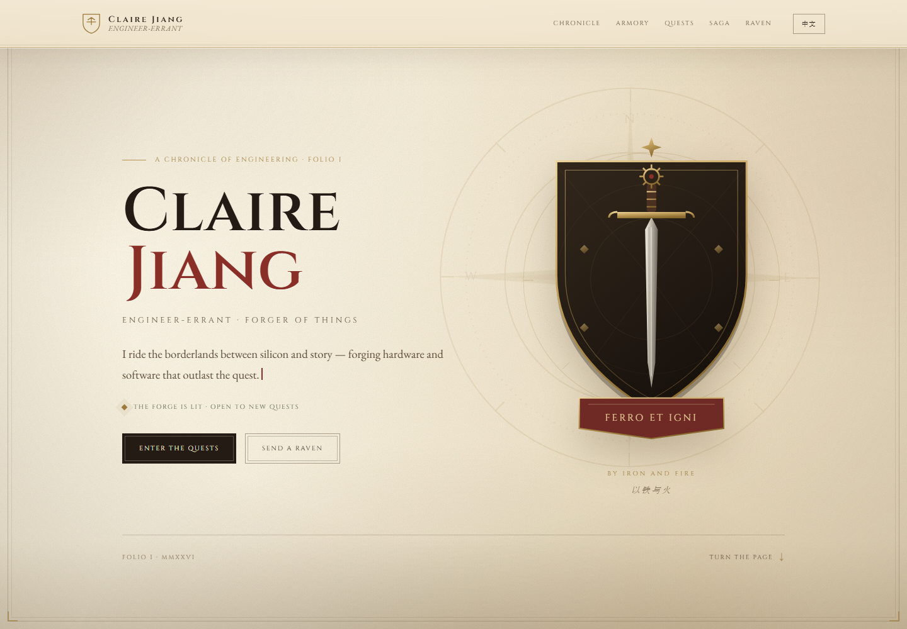

# Claire Jiang — The Chronicle of an Engineer · 工程师编年史

一部以**中世纪骑士探险故事**为视觉语言的个人工程作品集：羊皮纸、铁胆墨、纹章深红与烫金，配一枚手绘盾徽、火漆启封动画和一张「远征」地图式的版式。

**纯静态、零依赖、无需构建**：双击 `index.html` 就能本地预览，也可以直接部署到 GitHub Pages。所有内容都集中在 [`js/data.js`](js/data.js) 一个文件里，以后加项目、技能、经历只需要改这一个文件。



---

## 视觉与结构

| 元素 | 说明 |
| --- | --- |
| 底色 | 羊皮纸米色 + 纸纹噪点 + 暗角，没有霓虹、没有大面积发光 |
| 主色 | 铁胆墨 `#241c14`、纹章深红 `#8a2f28`、烫金 `#b8954f` |
| 字体 | Cinzel（标题/铭牌）+ EB Garamond（正文），**字体文件已本地化**，不依赖 Google Fonts |
| 盾徽 | 手写 SVG：剑、齿轮、罗盘、绶带箴言 `FERRO ET IGNI`（以铁与火） |
| 开场 | 火漆封印 + 点击启封（同一会话只出现一次，可点击跳过） |
| 版式 | 序章 → 编年史 → 军械库 → 远征 → 传奇 → 传书；章节号、远征号自动编号 |
| 语言 | 右上角「中文 / EN」一键切换，选择会记住 |

中文界面下标题会回退到系统宋体（Windows 宋体 / macOS Songti），正文仍保持阅读舒适。

---

## 目录结构

```
personalweb/
├── index.html                  # 页面骨架 + 盾徽/罗盘 SVG（一般不用改）
├── css/
│   └── style.css               # 全部样式：配色、字体、动效、响应式
├── js/
│   ├── data.js                 # ★ 所有内容都在这里（加项目/技能/经历改这里）
│   └── main.js                 # 渲染、双语、自动编号、启封动画（一般不用改）
├── assets/
│   ├── fonts/                  # 自托管字体（woff2）
│   └── favicon.svg             # 盾徽图标
├── .github/workflows/deploy.yml # GitHub Actions 自动部署（可选）
├── preview.png                 # 预览图
└── README.md
```

---

## 本地预览

**最简单：直接双击 `index.html`。** 整个站点不需要服务器、不需要安装任何东西。

如果想用本地服务器（更接近线上环境）：

```bash
# 任选其一
python -m http.server 8000
npx serve .
```

然后打开 `http://localhost:8000/`。

> 若只想截一张没有开场动画的图：在地址后加 `?capture`，例如 `index.html?capture`。
> 想直接看某个区块：`?capture&at=quests`；想临时切中文：`?lang=zh`。

---

## 怎么加新内容（重点）

所有可翻译字段写成对象 `{ en: "English", zh: "中文" }`；年份、邮箱、链接等直接写字符串。**数组里的顺序就是页面顺序，编号会自动生成，不需要手动写 I、II、III。**

### 1. 加一个新项目 / 远征

打开 [`js/data.js`](js/data.js)，找到 `projects: [ ... ]`，在最后一个项目后面加一个逗号，然后粘贴：

```js
    {
      title: "My New Quest",
      subtitle: { en: "one-line description", zh: "一句话简介" },
      year: "2026",
      status: { en: "IN THE FORGE", zh: "锻造中" },
      statusKey: "forge",        // victory / forge / ongoing（控制徽章颜色）
      icon: "quill",             // sword / anvil / quill / compass / tower（卡片水印）
      summary: {
        en: "What it does, in a couple of sentences.",
        zh: "用两三句话说明它做什么。"
      },
      highlights: [
        { en: "highlight one", zh: "亮点一" },
        { en: "highlight two", zh: "亮点二" }
      ],
      tech: ["React", "Node.js"],
      link: "https://demo.example.com",    // 没有就留 ""
      repo: "https://github.com/you/repo"  // 没有就留 ""
    },
```

可选字段：

| 字段 | 作用 |
| --- | --- |
| `featured: true` | 让这张卡片在桌面端横跨两列，做「旗舰远征」。建议只给一个项目加 |
| `statusKey` | `victory` 金色 / `forge` 红色 / `ongoing` 蓝色 |
| `icon` | 卡片右下角的淡色水印图标：`sword` `anvil` `quill` `compass` `tower` |
| `link` / `repo` | 留空字符串 `""` 时不显示对应按钮 |
| `highlights` / `tech` | 可以整段删掉，卡片会自动收拢 |

### 2. 加一类技能

```js
    {
      icon: "compass",   // sword / anvil / quill / compass / tower
      category: { en: "NEW CATEGORY", zh: "新分类" },
      items: ["A", "B", "C"]
    },
```

### 3. 加一段经历

```js
    {
      period: "2026 — NOW",
      role: { en: "Role", zh: "职位" },
      org:  { en: "Company", zh: "公司" },
      description: { en: "...", zh: "..." },
      tech: ["C++", "Rust"]
    },
```

### 4. 改名字 / 箴言 / 邮箱 / 社交链接

- 姓名：`meta.name` 和 `hero.name`（两处都改）。
- 盾徽字母、绶带箴言：`meta.crest`、`meta.mottoLatin`、`meta.motto`。
- 邮箱、坐标、社交链接：文件底部的 `contact`。
- 首页 CTA、导航文案：`ui.heroActions`、`ui.nav`。

> 现在 `data.js` 里的邮箱、公司、学校仍是占位内容（`claire.jiang@example.com`、`[ Your company ]`、`[ Your university ]`），上线前记得替换。

### 5. 改默认语言

`js/main.js` 顶部：

```js
var lang = 'en';   // 改成 'zh' 则默认中文
```

浏览器里点过语言按钮后会记住选择（localStorage 键 `pw_lang`），所以改默认值后可以清一下站点数据再看。

### 6. 改配色 / 字体

配色都在 `css/style.css` 顶部的 `:root` 里：

```css
--vellum: #efe3c8;   /* 羊皮纸 */
--ink: #241c14;      /* 铁胆墨 */
--rubric: #8a2f28;   /* 纹章深红 */
--gold: #9c7a3c;     /* 烫金 */
--gold-3: #d8ba7c;   /* 深色卡片上的金字 */
```

字体在 `assets/fonts/`，`@font-face` 在 `css/style.css` 顶部。

---

## 部署到 GitHub Pages

项目已经是纯静态站点，下面两种方式**二选一**即可，不要混用。

### 方式 A：GitHub Actions（推荐，仓库已带工作流）

1. 登录 GitHub → 右上角 **＋ → New repository**，仓库名建议 `portfolio`（或其他名字），**Public**，不要勾选 README，创建。
2. 进入空仓库 → **Add file → Upload files**，把本目录里的 **`index.html`、`css/`、`js/`、`assets/`、`.github/`、`preview.png`、`README.md`** 拖进去，Commit。
3. **Settings → Pages → Source** 选 **GitHub Actions**。
4. 之后每次 commit 都会自动构建并发布。等 1～2 分钟，**Settings → Pages** 顶部会显示网址：
   - 仓库名是 `portfolio` → `https://你的用户名.github.io/portfolio/`
   - 仓库名是 `你的用户名.github.io` → `https://你的用户名.github.io/`

### 方式 B：branch 部署（不想用 Actions 时）

1. 同上创建仓库并上传文件，但**不要上传 `.github/` 目录**（避免工作流找不到 Pages 配置而报错）。
2. **Settings → Pages → Source** 选 **Deploy from a branch** → Branch 选 **`main`**、目录 **`/ (root)`** → Save。
3. 等 1～2 分钟，网址同上。

> 如果已经按方式 A 把 Source 设成了 GitHub Actions，就不要再切到 branch；反之亦然。

### 以后怎么更新（不用装 Git）

部署完成后，直接在 GitHub 网页里：

1. 打开仓库 → `js/data.js` → 右上角铅笔图标 **Edit**。
2. 加一个项目块 → **Commit changes**。
3. 等 1 分钟，刷新网站即可看到新内容。

这就是这个站「随时方便加新内容」的核心：**只改一个文件，不碰 HTML/CSS。**

---

## 常见问题

**改了 `data.js` 页面没变？**
浏览器缓存，按 `Ctrl/Cmd + Shift + R` 强制刷新；如果是 GitHub Pages，等 1～2 分钟构建。

**开场动画不想看？**
点击画面任意处即可跳过；同一浏览器会话里只出现一次。想彻底关掉，可删掉 `index.html` 里的 `.seal-overlay` 整段，或在 `js/main.js` 的 `initSeal` 里让它直接结束。

**字体没有生效？**
字体在 `assets/fonts/`，是本地文件，不联网也能用。极少数浏览器用 `file://` 打开时会拦截本地字体，换成本地服务器（见上文）即可。

**想换盾徽 / 剑的造型？**
盾徽是 `index.html` 里的一段内联 SVG（搜索 `class="crest"`），颜色和线条都可以直接改。

**手机端排版？**
已在 512px、768px、1024px、1440px 下检查；断点主要在 `900px`、`720px`、`640px`、`460px`。

---

## 说明

- 站点是纯前端静态文件，没有后端、没有构建步骤、没有第三方脚本。
- 字体 Cinzel / EB Garamond 均为 SIL Open Font License，已本地化在 `assets/fonts/`。
- 示例项目内容可在 `js/data.js` 中按需替换。
